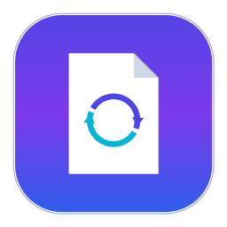

# ⚡ Universal File Converter Pro

<div align="center">



**A modern, private, and high-performance desktop tool for converting and manipulating PDFs, Word documents, images, and text files.**

[](https://python.org)
[](https://github.com/TomSchimansky/CustomTkinter)
[](LICENSE)
[](https://github.com)

</div>

---

## 🌟 Key Highlights

- 🔒 **100% Private & Offline**: No cloud servers, no file size limits, and no subscriptions. All document processing stays completely local on your device.
- 🎨 **Modern Fluent / Linear UI**: Adaptive Light & Dark themes, Windows 11 immersive dark title bar integration, and clean typography.
- 📥 **Drag & Drop Workspace**: Drop single files or entire directory trees directly into the window.
- ⚡ **Batch Processing & Reordering**: Queue multiple documents, reorder items for merging or combining, and sort alphabetically with a click.
- 🛡️ **Zero Console Window**: Launches seamlessly without opening command prompt windows via `UniversalConverter.pyw` or the native desktop shortcut.
- 📊 **Real-time Live Engine**: Deterministic progress reporting, non-blocking cancellation, activity log drawer, and automatic collision protection.

---

## 🛠️ Supported Operations

### 📄 PDF Studio
| Operation | Description | Options |
|---|---|---|
| **Convert to Word** | Turns PDF pages into editable `.docx` documents. | Page range |
| **Extract to Excel** | Automatically detects tables and exports each page to `.xlsx` sheets. | Page range |
| **Extract Text** | Extracts all selectable text into clean `.txt` format. | Page range |
| **Render to PNG / JPG** | Converts pages to high-resolution images. | Page range, DPI (72-600), Quality |
| **Merge PDFs** | Joins multiple PDFs in queue order into a single unified document. | Output file name |
| **Split Pages** | Splits each document page into individual PDF files. | Page range |
| **Extract Pages** | Extracts custom page sequences (e.g. `1-3, 5, 8-`). | Custom page spec |
| **Rotate Pages** | Rotates orientation (90° CW, 180°, 90° CCW). | Angle, page range |
| **Compress & Optimize** | Downsamples images and strips redundant streams for smaller size. | Light / Balanced / Strong |
| **Encrypt & Protect** | Adds password encryption using AES-256 standard. | Password |
| **Remove Password** | Decrypts and saves an unprotected PDF copy. | Current password |

### 📝 Word Documents
| Operation | Description |
|---|---|
| **Convert to PDF** | Converts `.docx`, `.doc`, `.rtf`, `.odt` to PDF using native Microsoft Word automation with automatic headless LibreOffice fallback. |

### 🖼️ Image Studio
| Operation | Description | Options |
|---|---|---|
| **Image to PDF** | Converts individual images to standalone PDF pages. | Fit to Image, A4, US Letter |
| **Combine into PDF** | Binds all queued images into a multi-page PDF document. | Page layout, output name |
| **Batch Format & Resize** | Converts between PNG, JPG, WEBP, and BMP with downscaling options (25% to 100%). | Target format, quality, scale |

### 📑 Plain Text & Markdown
| Operation | Description | Options |
|---|---|---|
| **Text to PDF** | Renders `.txt`, `.md`, `.log`, `.csv` into clean PDFs with automatic word-wrapping, page numbers, and Unicode system fonts. | Font family, font size |

---

## 🚀 Quick Start

### 1. Requirements & Installation
Ensure you have Python 3.10 or higher installed. Clone this repository and install dependencies:

```bash
git clone https://github.com/Yosef213/Universal-File-Converter.git
cd Universal-File-Converter
pip install -r requirements.txt
```

### 2. Launching the Application
- **Option A (No Console / Direct GUI)**: Double-click **`UniversalConverter.pyw`** or **`Launch.vbs`**.
- **Option B (Desktop Shortcut)**: Run `python create_shortcut.py` once to place a shortcut on your Desktop with the custom icon.
- **Option C (Terminal)**:
  ```bash
  python main.py
  ```

---

## 📦 Building Standalone Windows Executable (.exe)

You can compile a single standalone `.exe` that runs on any Windows machine without requiring Python:

```bash
pip install pyinstaller
python build_exe.py
```

The resulting executable will be saved in `dist/UniversalFileConverter.exe` with:
- Windowed mode (`--noconsole`) — no terminal popup.
- Embedded multi-resolution application icon.
- Bundled UI themes and drag & drop libraries.

---

## ⌨️ Keyboard Shortcuts

| Shortcut | Action |
|---|---|
| `Ctrl + O` | Browse and add files |
| `Ctrl + Enter` | Start conversion |
| `Escape` | Cancel active operation |

---

## 🏗️ Architecture

```
Universal-File-Converter/
├── assets/
│   ├── icon.ico             # Windows multi-size application icon
│   └── icon.png             # High-res 1024x1024 vector icon
├── main.py                  # Core application engine & CustomTkinter UI
├── UniversalConverter.pyw   # Windowless Python entrypoint (no cmd)
├── Launch.vbs               # Silent VBS launcher
├── create_shortcut.py       # Desktop shortcut installer script
├── build_exe.py             # PyInstaller executable builder
├── requirements.txt         # Package dependencies
├── .gitignore               # Git exclude rules
├── LICENSE                  # MIT License
└── README.md                # Documentation
```

### Core Design Principles
- **Thread Safety**: UI interactions and background worker operations are decoupled through thread-safe `queue.Queue` channels.
- **Fail-Safe Output**: Auto-incrementing naming ensures no file is accidentally overwritten unless explicitly enabled.
- **Native OS Hooks**: Windows DWM API integration provides dark title bars and native taskbar icon grouping.

---

## 📄 License

Distributed under the **MIT License**. See [`LICENSE`](LICENSE) for details.
